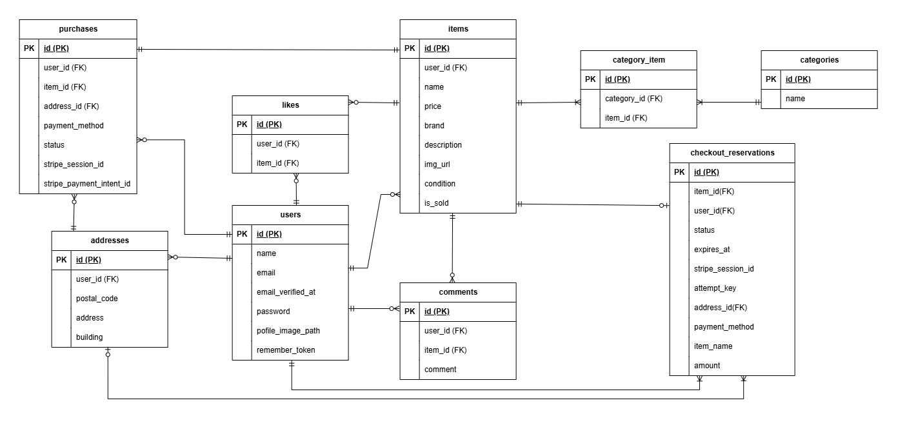

# COACHTECH フリマアプリ

Laravel × Docker を用いて開発したフリマアプリです。

ユーザー登録、メール認証、出品、購入、いいね、コメント、商品検索、Stripe決済などの基本機能を備えています。

PHP 7.4 / Laravel 8で開発したアプリを、PHP 8.4 / Laravel 13へアップデートしました。あわせて、Stripe決済の成功判定と購入状態の管理を改修しています。

## 主な機能
- 会員登録・ログイン・ログアウト
- メール認証
- 商品一覧・商品詳細
- 商品名検索
- 商品出品
- いいね・コメント
- 商品購入
- Stripeによるクレジットカード決済・コンビニ決済
- マイページ
- 購入済み商品の表示

## 環境構築

### Dockerビルド

1.リポジトリのクローン

```bash
git clone https://github.com/nishidanamiki/flea-market-app.git
cd flea-market-app
```

2.DockerDesktop アプリを立ち上げる  
3.`docker compose up -d --build`

※ 使用するPCでポート80、8080、8025、1025が利用可能であることを確認してください。

> _Mac の M1・M2 チップの PC の場合、`no matching manifest for linux/arm64/v8 in the manifest list entries`のメッセージが表示されビルドができないことがあります。
> エラーが発生する場合は、docker-compose.yml ファイルの「mysql」内に「platform」の項目を追加で記載してください_

```yaml
mysql:
  platform: linux/x86_64 # ← この文を追加
  image: mysql:8.0.26
  environment:
```

### Laravel環境構築

1.`docker compose exec php composer install`  
2.「.env.example」ファイルをコピーし「.env」ファイルを作成

```bash
cp src/.env.example src/.env
```

3..env に以下の環境変数を追加

```text
DB_CONNECTION=mysql
DB_HOST=mysql
DB_PORT=3306
DB_DATABASE=laravel_db
DB_USERNAME=laravel_user
DB_PASSWORD=<DockerComposeで設定したパスワード>

MAIL_MAILER=smtp
MAIL_HOST=mailhog
MAIL_PORT=1025
MAIL_USERNAME=null
MAIL_PASSWORD=null
MAIL_ENCRYPTION=null
MAIL_FROM_ADDRESS="no-reply@coachtech-fleamarket.local"
MAIL_FROM_NAME="COACHTECHフリマ"

STRIPE_KEY=your_key
STRIPE_SECRET=your_secret
```

4.アプリケーションキーの作成

```bash
docker compose exec php php artisan key:generate
```

5.マイグレーションの実行

```bash
docker compose exec php php artisan migrate
```

6.シーディングの実行

```bash
docker compose exec php php artisan db:seed
```

7.ストレージリンクの生成

```bash
docker compose exec php php artisan storage:link
```

## Stripe の設定（決済機能を利用する場合）

このアプリでは Stripe（テストモード）で決済を行います。

### 1. Stripe テストキーの取得

以下の URL から「公開可能キー（pk*test*〜）」と
「シークレットキー（sk*test*〜）」を取得してください。

https://dashboard.stripe.com/test/apikeys

### 2. .env に設定

```env
STRIPE_KEY=pk_test_xxxxxxxxxxxxxxxx
STRIPE_SECRET=sk_test_xxxxxxxxxxxxxxxx
STRIPE_WEBHOOK_SECRET=whsec_xxxxxxxxxxxxxxxx
```

※ 上記はダミーです。実際のテストキーを使用してください。

### 3. Webhookの設定

Webhookの受信先は次のとおりです。

POST /stripe/webhook

ローカル環境でStripe CLIを使用

```bash
stripe listen --forward-to http://localhost/stripe/webhook
```

Stripe CLIに表示されるWebhook署名シークレットを、.envのSTRIPE_WEBHOOK_SECRETに設定してください。

### 4. 決済処理
**クレジットカード決済**

Stripeの支払い完了状態を確認した後、購入確定処理を行います。

**コンビニ決済**

支払い待ちの状態を管理し、Stripeから支払い完了通知を受信した後に購入を確定します。

**対応するWebhookイベント**

- checkout.session.completed
- checkout.session.async_payment_succeeded
- checkout.session.async_payment_failed
- checkout.session.expired

Webhookでは署名検証を行い、不正な通知を拒否します。


### 5. テスト決済用カード番号

Stripe のテストカード：

- カード番号：4242 4242 4242 4242
- 有効期限：未来の日付
- CVC：任意の 3 桁
- 郵便番号：任意

## テスト環境の準備

1. `.env.testing`を作成。

```bash
cp src/.env.example src/.env.testing
```

テスト用 DB 名を設定(.env.testing 内)

```env
APP_ENV=testing
APP_DEBUG=true

DB_CONNECTION=mysql_test
DB_HOST=mysql
DB_PORT=3306
DB_DATABASE=demo_test

CACHE_DRIVER=array
SESSION_DRIVER=array
QUEUE_CONNECTION=sync

MAIL_MAILER=array
MAIL_FROM_ADDRESS=hello@example.com
```

2.テスト用データベースを作成

```bash
docker compose exec mysql mysql -u root -p -e "CREATE DATABASE IF NOT EXISTS demo_test;"
```

3.テスト用マイグレーション

```bash
docker compose exec \
  -e APP_ENV=testing \
  -e DB_CONNECTION=mysql_test \
  -e DB_DATABASE=demo_test \
  php php artisan migrate
```

4.テスト実行

```bash
docker compose exec \
  -e APP_ENV=testing \
  -e DB_CONNECTION=mysql_test \
  -e DB_DATABASE=demo_test \
  php ./vendor/bin/phpunit
```

## 使用技術（実行環境）

- PHP 8.4.27
- Laravel 13.38.0
- MySQL 8.0.26
- Nginx 1.21.1
- PHPUnit 12.5.40
- Stripe API
- MailHog
- phpMyAdmin

※ バージョンは環境更新後に確認したものです。

## ER 図



## URL

- 開発環境: http://localhost/
- phpMyAdmin: http://localhost:8080/
- MailHog: http://localhost:8025
